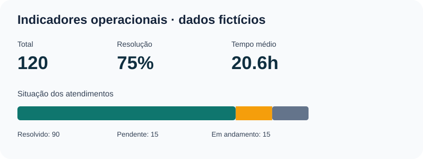

# Análise de dados operacionais 📊

Este é um projeto pequeno de portfólio para mostrar, de forma prática, como organizar uma base de dados e transformar informações em indicadores úteis.

Usei **Python, Pandas e Matplotlib** para analisar atendimentos fictícios, calcular resultados e visualizar os dados.



## O que a análise mostra

- **120 atendimentos** analisados
- **75%** de atendimentos resolvidos
- **20.6 horas** de tempo médio
- Volume de atendimentos por mês e por situação

## O que foi feito

Leitura de CSV, remoção de registros duplicados, validação de campos, cálculo de indicadores e geração de gráficos.

## Como executar

```bash
pip install -r requirements.txt
python analise.py
```

O programa cria `imagens/indicadores.png` com os gráficos.

## Arquivos

- `analise.py` — código da análise
- `dados/atendimentos.csv` — base de exemplo
- `imagens/resumo.svg` — visão rápida dos resultados
- `requirements.txt` — bibliotecas utilizadas

**Nota:** a base é inteiramente simulada para fins de portfólio; nenhum dado de cliente ou empresa foi utilizado.
